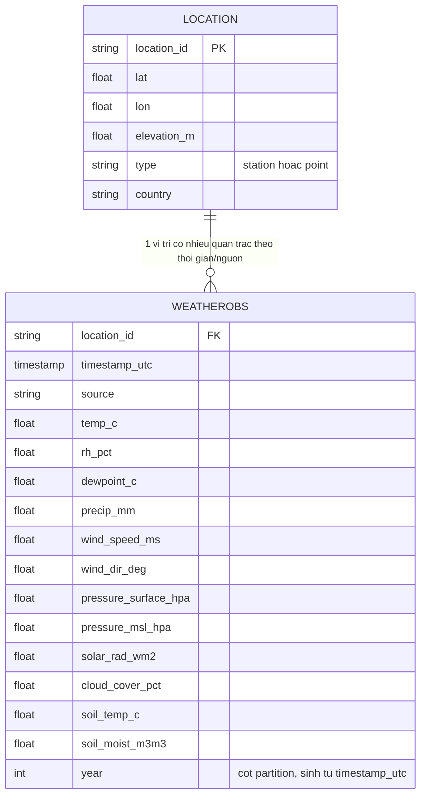

# Data Model Design v1 — ERD, Naming Convention, Lựa chọn công cụ nội suy

Gộp 3 tác vụ TV2 (`docs/03`: Tuần 1 #2+#6+#8) vào 1 tài liệu vì chúng cùng mô tả 1 thứ: cách dữ liệu
được đặt tên và tổ chức trong warehouse. Khác với bản thiết kế lý thuyết ở `docs/06`, tài liệu này mô
tả đúng những gì **đã chạy thật** trong `ingestion/` và `warehouse/`.

---

## 1. ERD — đã triển khai thật (1 fact + 1 dimension)

**So với thiết kế ban đầu ở `docs/06` mục 2:** bản thiết kế gốc dự kiến `Location` có thêm phân loại
`grid_cell` (ô lưới ERA5 độc lập). Bản triển khai thật đã **đơn giản hoá**: thay vì vật chất hoá từng
ô lưới ERA5 thành 1 dòng Location riêng (sẽ ra ~27.000 ô lưới cho vùng ĐNA ở độ phân giải 0.25°, không
cần thiết), dữ liệu ERA5 được **nội suy song tuyến tính thẳng vào toạ độ trạm** (`warehouse/interpolation.py`)
rồi gắn `location_id` trùng với trạm — cho phép so sánh trực tiếp ERA5 vs trạm tại cùng 1 khoá trong
Survivorship mà không cần bảng `grid_cell` riêng. Đây là quyết định thiết kế có chủ đích, không phải
thiếu sót.

**Giới hạn đã biết (ghi nhận trung thực):** GHCN và ISD dùng 2 hệ mã trạm độc lập cho cùng 1 vị trí vật
lý (xem `docs/10-ket-qua-ky-thuat-tuan-2.md` mục 1) — `Location` hiện coi đây là 2 `location_id` khác
nhau dù có thể trùng toạ độ. Chưa có bước Entity Resolution hợp nhất 2 ID này — việc cần làm thêm nếu
muốn so sánh trực tiếp GHCN vs ISD tại cùng 1 trạm vật lý.

## 2. Naming convention — đã áp dụng nhất quán trong code

| Quy tắc | Ví dụ | Áp dụng tại |
|---|---|---|
| Tên cột: `snake_case`, đơn vị ở hậu tố | `temp_c` (không phải `Temperature` hay `T`), `wind_speed_ms`, `pressure_msl_hpa` | `ingestion/parsers.py::WEATHEROBS_COLUMNS` |
| Thời gian: luôn `timestamp_utc`, kiểu `datetime64[ns, UTC]` (không bao giờ naive) | `pd.to_datetime(..., utc=True)` | Mọi hàm `parse_*()` |
| Khoá chính nguồn dữ liệu: `location_id` (string, không ép kiểu số dù ISD id toàn số) | `"48900099999"` | `parsers.py`, `location.py` |
| Tên nguồn: `UPPER_SNAKE_CASE`, khớp đúng tên trong `SOURCE_PRIORITY` | `"GHCN"`, `"NASA_POWER"`, `"OPEN_METEO"` | `survivorship.py` |
| Tên file script theo động từ hành động | `build_warehouse.py`, `check_spark_env.py` | `warehouse/`, `scripts/` |
| Đơn vị chuẩn hoá: **°C** (không phải K), **hPa** (không phải Pa), **m/s**, **mm** | — | Quyết định có chủ đích khác bản kế hoạch gốc (xem `docs/03` Tuần 2 TV1 #8, cột Trạng thái) |

## 3. Kriging vs Bilinear Interpolation — đã quyết định VÀ đã chạy thật

| Tiêu chí | Bilinear Interpolation | Kriging (`pykrige`) |
|---|---|---|
| Độ phức tạp cài đặt | Thấp — có sẵn trong `xarray.interp()` | Cao hơn — cần ước lượng variogram |
| Tốc độ | Nhanh (đã đo: 113 trạm × 72 mốc giờ × 4 biến = 8.136 dòng trong < 5 giây) | Chậm hơn đáng kể ở quy mô lớn |
| Độ chính xác | Đủ tốt cho lưới đều ERA5 (0.25°, biến thiên mượt theo không gian) | Tốt hơn ở vùng địa hình phức tạp/thưa trạm, có ước lượng sai số (variance) |
| Giả định | Biến thiên tuyến tính giữa 4 điểm lưới gần nhất | Mô hình hoá tương quan không gian (variogram) |

**Quyết định: dùng Bilinear làm mặc định** (đã triển khai thật trong `warehouse/interpolation.py`,
dùng `xarray.Dataset.interp(method="linear")`) — đúng khuyến nghị ban đầu "làm bước bắt buộc và rẻ
trước". `pykrige` đã cài đặt sẵn, để dành cho Tuần 3 nếu cần so sánh sai số tại vùng địa hình phức tạp
(núi phía Bắc VN, nơi Bilinear có thể kém chính xác hơn do biến thiên nhiệt độ theo độ cao không tuyến
tính).

## 4. So sánh công cụ Dashboard (TV4, `docs/03` Tuần 1 #4)

| Tiêu chí | Streamlit | Grafana | Apache Superset |
|---|---|---|---|
| Kết nối Parquet trực tiếp | Có, qua `pandas.read_parquet` (đã dùng thật) | Cần plugin/datasource riêng, phức tạp hơn | Cần cấu hình SQLAlchemy + Spark Thrift Server |
| Độ khó cài đặt | Thấp — `pip install streamlit`, 1 file Python | Trung bình — cần server riêng | Cao — cần DB backend riêng (Postgres), nhiều bước cấu hình |
| Tuỳ biến component tương tác (dropdown chọn trạm, v.v.) | Dễ — Python thuần | Giới hạn trong khung dashboard có sẵn | Giới hạn, hướng BI hơn là app tương tác |
| Phù hợp với quy mô nhóm (3 người, 6 tuần) | Phù hợp nhất — 1 thành viên dựng được toàn bộ nhanh | Quá nặng cho nhu cầu hiện tại | Quá nặng, cần hạ tầng DB riêng |

**Quyết định: Streamlit** — đã triển khai thật (`dashboard/app.py`), verify chạy sạch, đọc warehouse
Parquet thật (1.076.473 dòng), có dropdown chọn trạm + line chart tương tác.
